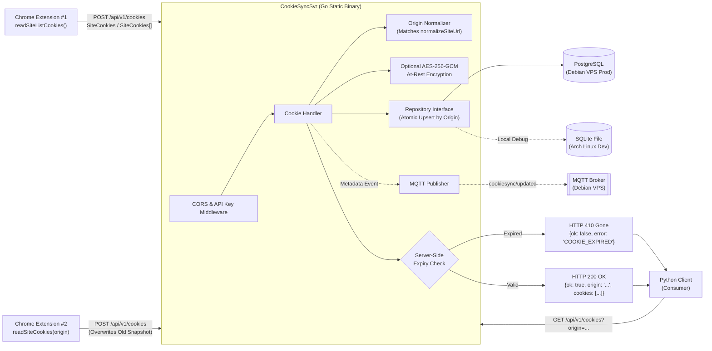

# Architecture & Technical Design: CookieSyncSvr

## 1. Alignment with `CookieSyncChromeExtension`

After inspecting `CookieSyncChromeExtension`, the extension uses the following core TypeScript structures:
- **`src/sites/site.ts`**:
  ```ts
  export interface Site {
    origin: string;   // Normalized via normalizeSiteUrl(), e.g. "https://example.com"
    addedAt: number;  // Unix timestamp in ms
  }
  ```
- **`src/cookies/cookies.ts`**:
  ```ts
  export interface SiteCookies {
    origin: string;
    cookies: chrome.cookies.Cookie[];
  }
  ```
- **`src/settings/server-url.ts`**:
  - Stores normalized server base URL in `cookiesync.serverUrl` (e.g. `https://api.example.com`).

`CookieSyncSvr` mirrors these exact types so the Chrome Extension can `POST` the return value of `readSiteCookies(origin)` or `readSiteListCookies()` directly to `${serverUrl}/api/v1/cookies`, and the Python client can `GET ${serverUrl}/api/v1/cookies?origin=https://example.com`.

---

## 2. System Architecture Diagram



---

## 3. Data Model & Expiration Verification

### 3.1 Go Models (`internal/model/cookie.go`)
```go
type ChromeCookie struct {
    Domain         string   `json:"domain"`
    ExpirationDate *float64 `json:"expirationDate,omitempty"` // Seconds since UNIX epoch
    HostOnly       bool     `json:"hostOnly"`
    HttpOnly       bool     `json:"httpOnly"`
    Name           string   `json:"name"`
    Path           string   `json:"path"`
    SameSite       string   `json:"sameSite"`
    Secure         bool     `json:"secure"`
    Session        bool     `json:"session"`
    StoreID        string   `json:"storeId,omitempty"`
    Value          string   `json:"value"`
}

type SiteCookies struct {
    Origin    string         `json:"origin"`
    Site      string         `json:"site,omitempty"` // Alias for convenience
    UpdatedAt int64          `json:"updatedAt"`      // Unix milliseconds
    Cookies   []ChromeCookie `json:"cookies"`
}
```

### 3.2 Server-Side Cookie Expiration Logic
When the Python client requests `GET /api/v1/cookies?origin=https://example.com`:
1. The server retrieves the stored `SiteCookies` for `https://example.com`.
2. If no record exists or `len(cookies) == 0`, returns `404 Not Found` (`error: "SITE_NOT_FOUND"`).
3. The server checks each cookie against `now := float64(time.Now().Unix())`:
   - If `!c.Session && c.ExpirationDate != nil`:
     - Handle both Unix seconds (Chrome standard, e.g. `1762876000.123`) and accidental milliseconds (`> 1e11`).
     - If `expSeconds <= now`, the cookie name is added to `expiredCookies`.
4. If `len(expiredCookies) > 0`, the server returns `HTTP 410 Gone`:
   ```json
   {
     "ok": false,
     "error": "COOKIE_EXPIRED",
     "origin": "https://example.com",
     "message": "Cookies for https://example.com have expired",
     "expiredCookies": ["session_id"],
     "updatedAt": 1731340000000
   }
   ```
5. Otherwise, returns `HTTP 200 OK` with the full `SiteCookies` object.

---

## 4. Storage Design (PostgreSQL + SQLite + Optional MQTT)

### SQL Schema
```sql
CREATE TABLE IF NOT EXISTS site_cookies (
    origin          TEXT PRIMARY KEY,               -- Normalized origin, e.g. 'https://example.com'
    cookies_data    TEXT NOT NULL,                  -- JSON array of ChromeCookie[] (or AES-GCM encrypted base64)
    cookie_count    INTEGER NOT NULL DEFAULT 0,
    min_expires_at  DOUBLE PRECISION,               -- Earliest expirationDate in seconds (NULL if session-only)
    updated_at      BIGINT NOT NULL                 -- Unix timestamp in milliseconds
);
```
- **Multi-Extension Overwrite**: `INSERT INTO site_cookies ... ON CONFLICT (origin) DO UPDATE SET ...` atomically replaces the old snapshot with the latest push.
- **PostgreSQL (`DB_DRIVER=postgres`)**: Uses `github.com/jackc/pgx/v5/pgxpool` to connect to the existing PostgreSQL service on the Debian VPS.
- **SQLite (`DB_DRIVER=sqlite`)**: Uses `modernc.org/sqlite` (pure Go, `CGO_ENABLED=0`) for effortless local debugging on Arch Linux (`./cookiesync.db`).
- **MQTT (`MQTT_BROKER_URL`)**: Uses `github.com/eclipse/paho.mqtt.golang` to publish lightweight update notifications (`{"origin":"https://example.com","updatedAt":...,"cookieCount":...}`) without exposing raw cookie values on broker topics (matching section 4 of `CookieSyncChromeExtension/docs/architecture.md`).

---

## 5. Build & Cross-Distribution Packaging

1. **Original Static Executable (`dist/cookiesyncsvr`)**:
   - Built with `CGO_ENABLED=0 GOOS=linux GOARCH=amd64 go build -trimpath -ldflags="-s -w"`.
2. **Way 1 — Arch Linux Package (`packaging/arch/PKGBUILD`)**:
   - Built via `makepkg -sf` -> produces `dist/cookiesyncsvr-0.1.0-1-x86_64.pkg.tar.zst`.
3. **Way 2 — Debian Package (`packaging/debian/build-deb.sh`)**:
   - Uses standard POSIX `ar` + `tar` + `gzip` (which are installed on Arch Linux out-of-the-box without requiring `dpkg-deb`) to construct a standards-compliant Debian `.deb` package (`dist/cookiesyncsvr_0.1.0_amd64.deb`) with `control`, `conffiles`, `postinst`, `prerm`, `/usr/bin/cookiesyncsvr`, `/lib/systemd/system/cookiesyncsvr.service`, and `/etc/cookiesyncsvr/config.env`.
